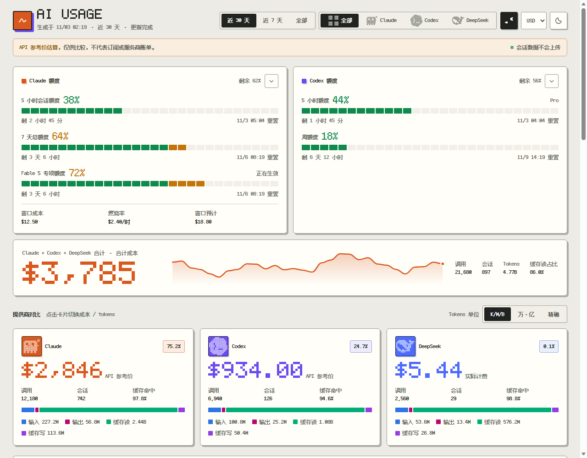
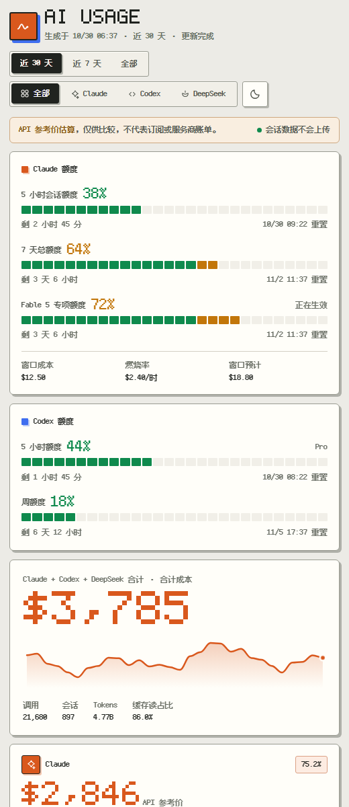

# AI Usage

[](https://github.com/AquariusCZ/ccusage-dashboard/actions/workflows/verify.yml)

**[中文说明](README.zh-CN.md)** · [How it is built](docs/ARCHITECTURE.md)

See how much you use **Claude Code**, **OpenAI Codex** and **DeepSeek**, and how much quota you
have left, on one page that runs on your own Windows PC. Your conversations never leave it.

<p align="center">
  
</p>

<table>
  <tr>
    <td width="72%"></td>
    <td width="28%"></td>
  </tr>
</table>

> Costs are **API reference-price estimates** for comparing tools and spotting trends. They are
> not what your subscription or provider actually charges you.

## What you get

- **The quota you have left.** Claude's 5-hour and weekly limits, including per-model limits,
  and your Codex plan quota: the answer to "am I about to be blocked?"
- **What your usage would cost** at public API prices, per tool and per model.
- **Claude, Codex and DeepSeek side by side:** cost, tokens, calls and sessions.
- **Your patterns:** a daily trend, an activity calendar with streaks, Claude's hour-of-day
  usage, and your top models, projects and sessions.
- **Three ranges:** the last 7 days, the last 30 days, and everything.
- **Easy to live with:** light and dark themes, a phone layout, keyboard navigation and
  reduced motion.

## Install

You need Windows 10 or 11 and [Node.js](https://nodejs.org/) 22.13 or newer (the current LTS is
fine).

```powershell
git clone https://github.com/AquariusCZ/ccusage-dashboard.git
cd ccusage-dashboard
powershell -ExecutionPolicy Bypass -File .\install.ps1
```

No Git? Download the ZIP, extract it, and double-click `install.bat`.

Then open the **AI Usage** shortcut on your desktop whenever you want a fresh look. The page
opens at once: your quota shows first, and each tool's usage fills in as soon as it has been
counted.

<details>
<summary>What the installer does</summary>

- It installs for your user only and refuses to run as administrator.
- It installs the two helpers AI Usage relies on, CodeBurn and ccusage, as global npm packages at
  the versions it was tested with. They stay installed if you remove AI Usage.
- It copies the app to `%LOCALAPPDATA%\ClaudeUsage` and creates the **AI Usage** desktop shortcut.
- It does not change your PowerShell execution policy.
- If an upgrade fails, it puts the previous version back; running it again repairs an interrupted
  install. The double-click wrappers pause on failure so an error cannot vanish with the window.

</details>

## Your data stays yours

- AI Usage only **reads** the usage records Claude Code, Codex and OpenCode already keep on your
  PC. It never changes them, and it never opens the Claude desktop app's encrypted login.
- Your prompts, tool arguments, API keys and provider addresses are never shown, saved or logged.
- The report is a temporary local page that deletes itself shortly after you have read it.
- It goes online only for what you would expect: checking your quota with the logins you already
  have, and fetching public model prices and exchange rates.

<details>
<summary>Every network request, in detail</summary>

| Purpose | Destination | Data sent |
|---|---|---|
| Read the real Claude quota | Anthropic OAuth usage endpoint | Your existing Claude Code OAuth token in the authorization header; no session content or usage figures |
| Read a ChatGPT login's Codex quota | OpenAI, by the official Codex CLI (`codex app-server`) | Codex's own request with its own login; AI Usage never reads or forwards that credential |
| Read a relay's Codex quota | The relay endpoint CC Switch already queries | Your existing Codex API key in a provider-declared, allowlisted header; no session content or usage figures |
| Refresh public model prices | GitHub raw content and models.dev | Public catalogue requests from CodeBurn (when its daily cache expires) and ccusage (each launch) |
| Refresh the currency switch's rates | Frankfurter public API (`api.frankfurter.dev`), at most once a day | Nothing but the public request for the rate table |
| Refresh a non-USD display currency | Frankfurter public API, by CodeBurn | The target ISO currency code only |

The Claude request needs a signed-in Claude Code CLI, the Codex app-server read needs a ChatGPT
Codex login, the relay request needs an API-key Codex login with a CC Switch usage query, and
CodeBurn's own exchange-rate request is inactive while it uses its default USD display currency.

Every credential stays read-only and never enters a snapshot, log or error message, and no
provider endpoint is written into the snapshot. A Codex relay key is put only into an audited
header and sent only to the exact HTTPS address CC Switch selected; anything else fails closed.
The Codex CLI runs in the same kill-on-close Job Object as every collector, with its own
30-second budget. A failed quota read never stops the rest of the page from showing.

The quota caches keep quota state and timestamps only. The Claude cache also keeps an opaque
SHA-256 digest of the signed-in account, so a logout or account switch never shows the previous
account's figures; the Codex cache keeps the selected CC Switch provider ID and an opaque
fingerprint of its configuration. Neither stores a token, API key, account identifier, provider
URL or authorization header. When the official Codex CLI answers it behaves as it always does,
so it may refresh its own login in `auth.json`; AI Usage itself never writes that file.

</details>

## Good to know

- **Claude says it is showing a saved record?** That happens when you only use the Claude desktop
  app, which keeps its own login. Run `claude auth login` once in a terminal to get live figures
  again; until then the card shows the newest record the official apps keep on disk, with its
  source and age.
- **Codex quota** comes from the account Codex is signed in with. If you use an API key through a
  relay set up in CC Switch, AI Usage asks that relay instead. When nothing answers, the last
  quota Codex wrote into its own sessions is shown, labelled.
- **DeepSeek** appears only if you use it through OpenCode. A small local ledger
  (`%LOCALAPPDATA%\AIUsage\deepseek-ledger.json`) keeps its history even after you delete OpenCode
  sessions, keeping only anonymous daily totals per model for deleted ones; delete that file to
  start over. A shared company account's balance cannot be split per API key, so only the calls
  OpenCode attributes to you are counted.
- **Model costs always add up to the total.** Anything that cannot be matched to a model is shown
  as *unattributed cost*, and incomplete token counts are marked as a lower bound (`≥`). If the
  current 5-hour window uses models the price list does not know yet, it reads *unpriced*
  rather than $0.00, or shows the part it could price as a lower bound.
- **Behind a proxy?** The price list ccusage downloads goes through the `HTTP_PROXY`/`HTTPS_PROXY`
  environment variables, not the Windows proxy setting.
- Click a provider card to switch between cost and tokens; the page remembers your choice, your
  folded cards and your theme.

## How it works

1. The desktop shortcut starts a small PowerShell script, which opens the page right away.
2. [CodeBurn](https://github.com/getagentseal/codeburn) and [ccusage](https://github.com/ccusage/ccusage)
   count your Claude and Codex usage from local logs; OpenCode's own database supplies DeepSeek.
3. Quota checks run at the same time, so a slow server never holds up the rest.
4. The page fills in as each part finishes, then stops checking for updates, and the temporary
   files are removed.

If something fails, the page says so at once instead of waiting forever, and a dashboard that is
already showing stays usable. The [architecture notes](docs/ARCHITECTURE.md) cover the data flow,
cost reconciliation, concurrency and failure handling.

## For developers

Generate and keep a debug snapshot (it is not deleted automatically, and it contains local
totals and project paths, so review it before sharing):

```powershell
powershell -NoProfile -ExecutionPolicy RemoteSigned -File .\src\Generate-ClaudeReport.ps1 -NoLaunch -KeepFile
```

Run the local checks:

```powershell
powershell -NoProfile -ExecutionPolicy RemoteSigned -File .\tests\ReportData.Tests.ps1
powershell -NoProfile -ExecutionPolicy RemoteSigned -File .\tests\Static.Tests.ps1
powershell -NoProfile -ExecutionPolicy RemoteSigned -File .\tests\Generator.Integration.Tests.ps1
powershell -NoProfile -ExecutionPolicy RemoteSigned -File .\tests\InstallJob.Tests.ps1
powershell -NoProfile -ExecutionPolicy RemoteSigned -File .\tests\Installer.Integration.Tests.ps1
powershell -NoProfile -ExecutionPolicy RemoteSigned -File .\tests\Uninstaller.Integration.Tests.ps1
node .\tests\BrowserSmoke.mjs
```

Remove the app and its shortcut:

```powershell
powershell -ExecutionPolicy Bypass -File .\uninstall.ps1
```

## Built on

- [CodeBurn](https://github.com/getagentseal/codeburn) normalizes Claude and Codex usage and
  applies public API reference prices.
- [ccusage](https://github.com/ccusage/ccusage) supplies the active 5-hour window and Claude's
  hour-of-day profile.
- OpenCode's own SQLite database supplies DeepSeek's per-call cost and tokens, opened read-only
  with no network call.
- Anthropic's usage endpoint, the official Codex CLI and CC Switch supply the quota.

The screenshots and the animation use synthetic data from `tests/New-DemoSnapshot.ps1`.

## License

[MIT](LICENSE)
