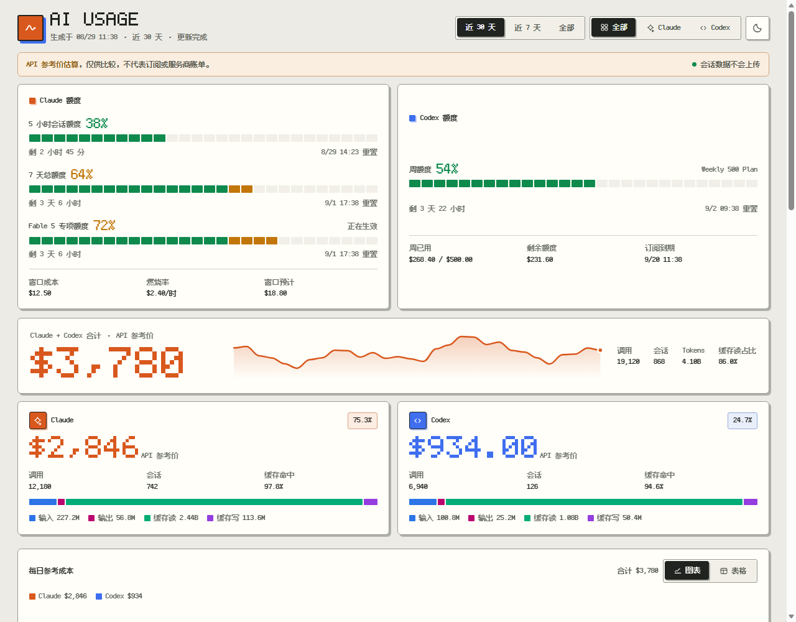
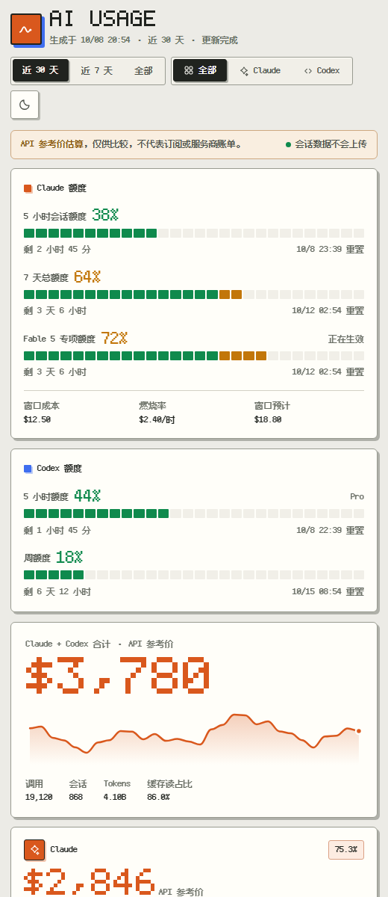

# AI Usage

[](https://github.com/AquariusCZ/ccusage-dashboard/actions/workflows/verify.yml)

*[中文说明](README.zh-CN.md)*

A local Windows dashboard for Claude Code and OpenAI Codex usage. It shows your real
Claude quota, compares both tools, and estimates cost from public API prices without
uploading session content.

Cost figures are for comparison and trend tracking. They are not subscription charges
or provider bills.

<table>
  <tr>
    <td width="72%"></td>
    <td width="28%"></td>
  </tr>
</table>

## What it shows

- Your real Claude 5-hour and 7-day quota, including per-model limits when available.
- Your real Codex plan quota, read from the account Codex is signed in with.
- Claude and Codex totals, shares, calls, sessions, tokens, and cache usage.
- Last 7 days, last 30 days, and full-history views.
- Daily trends, activity calendar, streaks, and Claude hour-of-day usage.
- Model composition, project ranking, high-usage sessions, and detailed tables.
- Light and dark themes, responsive layouts, keyboard navigation, and reduced motion.

Model costs always reconcile to the headline estimate. Any unresolved difference appears
as **unattributed cost**, and incomplete token totals are marked as lower bounds.

Claude quota is read live when the Claude Code CLI is signed in. The Claude desktop app keeps
its own login, so a desktop-only user has no CLI token; the card then shows the newest record
the official apps already keep on disk (Claude Code's last usage response, or the desktop app's
plan-usage samples) and labels its source and age. Running `claude auth login` once in a
terminal brings back live figures.

Codex quota follows how Codex is signed in. With a ChatGPT login, AI Usage asks the official
Codex CLI for the account's plan quota (`codex app-server`, the same call behind Codex's own
`/status`); Codex sends its own credential, and AI Usage never reads it. If Codex cannot answer,
the last plan-quota record Codex wrote into its local sessions is shown, labelled. With an
API-key login through a relay, AI Usage instead replays the quota call CC Switch already defines
for that provider. Usage and cost views remain available when no source answers.

The page opens on the quota cards within about a second; the usage report for the default
period follows as soon as CodeBurn finishes it.

## Install

Requirements are Windows 10 or 11 and Node.js 22.13.0 or newer; the current LTS is
recommended. The command below also needs Git.
Without Git, download the repository ZIP, extract it, and run `install.bat`.

```powershell
git clone https://github.com/AquariusCZ/ccusage-dashboard.git
cd ccusage-dashboard
powershell -ExecutionPolicy Bypass -File .\install.ps1
```

You can also double-click `install.bat`. The installer pins the audited CodeBurn and
ccusage versions, copies the runtime to `%LOCALAPPDATA%\ClaudeUsage`, and creates an
**AI Usage** desktop shortcut. Open that shortcut whenever you want a fresh snapshot.
Run the installer from a normal, non-elevated user session; this is a per-user utility and
the installer rejects administrator elevation.
CodeBurn and ccusage are installed as global npm packages and remain installed when
AI Usage is removed. The installer does not change your persistent PowerShell execution
policy. Runtime publication is staged under the same user profile and coordinated with
running reports across Windows sessions; a failed upgrade restores the previous managed
files and package versions. Interrupted dependency processes are terminated with the
installer, and rerunning it repairs an incomplete transaction or a damaged package manifest,
then removes installer-owned interruption residue.
The double-click wrappers pause on failure and preserve the PowerShell exit code so an error
cannot disappear with the console window.

## Privacy

- Claude Code and Codex session stores, Claude Code's `~/.claude.json`, the Claude desktop
  app's plan-usage history, Codex's `auth.json` (its login mode only), and the CC Switch
  database are read-only inputs. The desktop app's encrypted login is never opened.
- Prompt text, tool arguments, provider URLs, authorization headers, and credentials are
  excluded from the browser payload and logs.
- Normal launches keep temporary report files for a short read window, then delete them
  automatically. Cleanup retries Windows sharing violations; if a file remains locked, the
  next launch clears the labelled residue before opening another page.
- The retained quota caches contain quota state and timestamps. The Claude cache also keeps an
  opaque SHA-256 digest of the signed-in account, so a logout or account switch never shows the
  previous account's figures. The Codex cache keeps the selected CC Switch provider ID and an
  opaque SHA-256 configuration fingerprint, so switching providers or editing a key, endpoint, or
  usage script cannot reuse an old fresh value. Neither stores a raw token, API key, account
  identifier, provider URL, or authorization header.
- When the official Codex CLI answers a quota read it behaves as it always does, so it may refresh
  its own login in `auth.json`; AI Usage itself never writes that file.
- No previous full report is cached for faster startup; project paths and session identifiers
  remain disposable.

The runtime has five documented network paths. The Claude request needs a signed-in Claude
Code CLI, the Codex app-server read needs a ChatGPT Codex login, the relay request needs an
API-key Codex login with a CC Switch usage query, and the Frankfurter request is inactive while
CodeBurn uses its default USD display currency.

| Purpose | Destination | Data sent |
|---|---|---|
| Read the real Claude quota | Anthropic OAuth usage endpoint | Existing Claude Code OAuth token in the authorization header; no session content or usage aggregate |
| Read a ChatGPT login's Codex quota | OpenAI, by the official Codex CLI (`codex app-server`) | Codex's own request with its own login; AI Usage never reads or forwards that credential |
| Read a relay's Codex quota | The relay endpoint CC Switch already queries | Existing Codex API key in a provider-declared, allowlisted credential header; no session content or usage aggregate |
| Refresh public model prices | GitHub raw content | Public catalogue request; no credential or usage data |
| Refresh a non-USD exchange rate | Frankfurter public API | Target ISO currency code only |

Every credential stays read-only and never enters a snapshot, log, or error message, and no
provider endpoint is written into the snapshot. A Codex relay key is substituted only into an
audited header name and sent only to the exact HTTPS origin selected by CC Switch; control
characters and cross-provider destinations fail closed. The Codex CLI runs inside the same
kill-on-close Job Object as every collector, with its own 30-second budget. Quota failures do
not prevent the local dashboard from rendering.

## How it works

1. The hidden launcher starts `Generate-ClaudeReport.ps1`.
2. On an uncontended launch with healthy dependency preflight, the browser opens before
   collection. Quota reads start at once and run alongside CodeBurn, which builds the selected
   period first while ccusage reads its local window data offline. A report-lock wait or a
   cold public price/exchange-rate cache can add latency and is not hidden by the page.
3. The quota cards appear first, from local records within about a second and from live
   sources as they answer. After the two provider reports finish, the default period's usage
   follows; other periods and durable model attribution arrive as atomic updates. A durable
   status pass runs only for a report whose live models do not already add up to its total.
4. The page polls only until the final update; normal launches then remove the temporary files.

If the first local aggregation fails, the loader reports that failure immediately instead of
waiting for the polling timeout. A separate atomic, run-bound failure signal also stops an
already usable page if repeated final snapshot writes are denied. It never includes collector
output or credential details.
The failure page keeps the normal browser read window; reopening the shortcut requests a
bounded early close and then creates a fresh report instead of reusing the failed page.

CodeBurn runs one process at a time because its report command is not concurrency-safe.
A SID-scoped global Windows mutex protects both calls within one report and separate dashboard
launches. Reopening the shortcut while a report is still running reuses that page instead
of queuing another aggregation. Each collector also starts atomically inside a kill-on-close
Windows Job Object, so force-terminating or crashing the generator cannot leave an old
CodeBurn or ccusage process running into the next launch. Timeout and output-limit cleanup
waits until the complete Job process tree is empty before another CodeBurn call starts.
If process-tree cleanup cannot be proven, the current run immediately refuses every later
collector start and performs a conservative same-user process scan before releasing its lock.
Optional ccusage collection has one 120-second budget and a 16 MiB output cap from process
start; final collection cannot renew that budget.

See [Architecture](docs/ARCHITECTURE.md) for the data flow, cost reconciliation, currency
handling, network boundary, and design decisions.

## Useful commands

Generate and retain a debug snapshot.

```powershell
powershell -NoProfile -ExecutionPolicy RemoteSigned -File .\src\Generate-ClaudeReport.ps1 -NoLaunch -KeepFile
```

The command writes a separate `%TEMP%\ClaudeUsage\debug-<timestamp>-<pid>\` directory
and does not delete it automatically. The snapshot contains local aggregates and project
paths, so review it before sharing.

Run the local verification suite.

```powershell
powershell -NoProfile -ExecutionPolicy RemoteSigned -File .\tests\ReportData.Tests.ps1
powershell -NoProfile -ExecutionPolicy RemoteSigned -File .\tests\Static.Tests.ps1
powershell -NoProfile -ExecutionPolicy RemoteSigned -File .\tests\Generator.Integration.Tests.ps1
powershell -NoProfile -ExecutionPolicy RemoteSigned -File .\tests\InstallJob.Tests.ps1
powershell -NoProfile -ExecutionPolicy RemoteSigned -File .\tests\Installer.Integration.Tests.ps1
powershell -NoProfile -ExecutionPolicy RemoteSigned -File .\tests\Uninstaller.Integration.Tests.ps1
node .\tests\BrowserSmoke.mjs
```

Uninstall the local runtime and shortcut.

```powershell
powershell -ExecutionPolicy Bypass -File .\uninstall.ps1
```

## Data sources

- [CodeBurn](https://github.com/getagentseal/codeburn) normalizes Claude and Codex usage
  and applies public API reference prices.
- [ccusage](https://github.com/ccusage/ccusage) supplies active-window burn data and the
  Claude hour-of-day profile.
- Anthropic's OAuth usage endpoint supplies the real Claude plan quota; Claude Code's own
  cached response and the Claude desktop app's plan-usage samples stand in when the CLI is
  signed out.
- The official Codex CLI (`codex app-server`) supplies a ChatGPT login's plan quota; the
  `rate_limits` Codex writes into its sessions are the local fallback.
- CC Switch supplies the quota query for an API-key Codex provider it currently has selected;
  its database is read read-only and never written.

Screenshots use synthetic data generated by `tests/New-DemoSnapshot.ps1`.

## License

[MIT](LICENSE)
