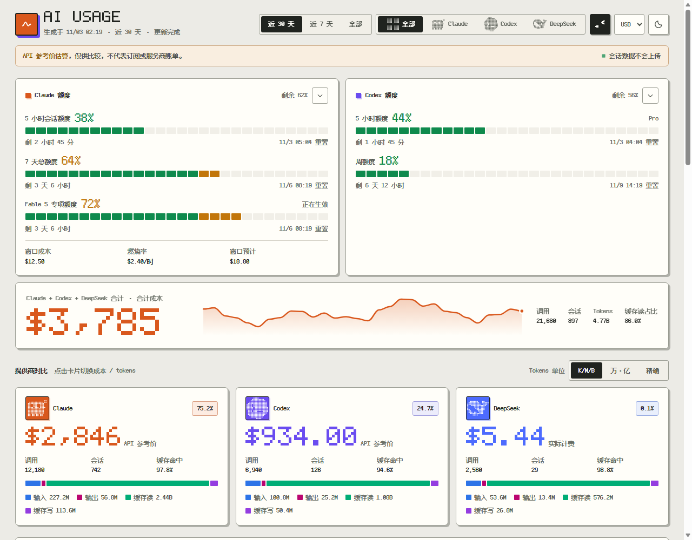
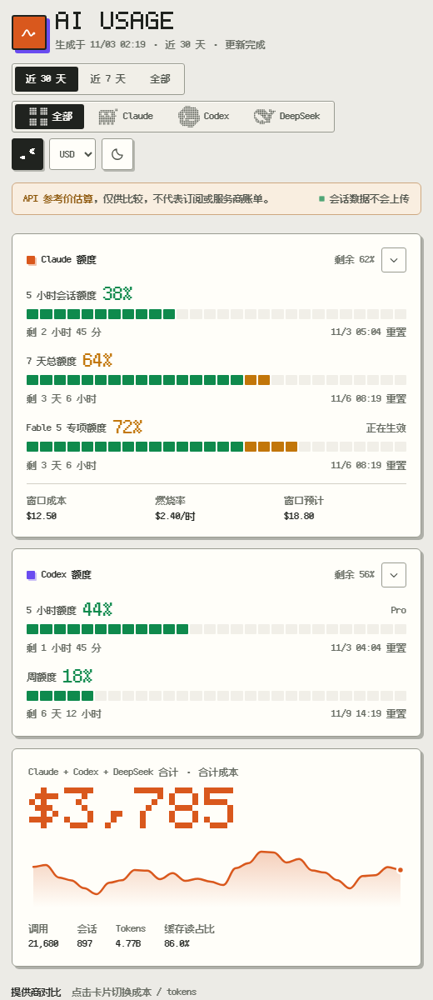

# AI Usage

[](https://github.com/AquariusCZ/ccusage-dashboard/actions/workflows/verify.yml)

**[English](README.md)** · [实现细节](docs/ARCHITECTURE.md)

一个在你自己 Windows 电脑上运行的页面，把 **Claude Code**、**OpenAI Codex** 和 **DeepSeek**
用了多少、额度还剩多少，放在一起给你看。对话内容不会离开你的电脑。

<p align="center">
  
</p>

<table>
  <tr>
    <td width="72%"></td>
    <td width="28%"></td>
  </tr>
</table>

> 成本按公开 **API 参考价**估算，用来对比工具、观察趋势，不是订阅费，也不是服务商实际账单。

## 能看到什么

- **还剩多少额度**：Claude 的 5 小时和每周额度（含按模型的额度），以及 Codex 套餐额度。一眼回答"我是不是快被限流了"。
- **按 API 价格算，这些用量值多少钱**：按工具、按模型分开算。
- **Claude、Codex、DeepSeek 并排对比**：成本、Token、调用次数、会话数。
- **你的使用习惯**：每日走势、带连续天数的活跃日历、Claude 按小时的用量分布，以及最常用的模型、项目和会话。
- **三个时间范围**：近 7 天、近 30 天、全部。
- **看着舒服**：明暗主题、手机布局、键盘操作，支持"减少动态效果"。

## 安装

需要 Windows 10 或 11，以及 [Node.js](https://nodejs.org/) 22.13 或更新版本（装当前 LTS 即可）。

```powershell
git clone https://github.com/AquariusCZ/ccusage-dashboard.git
cd ccusage-dashboard
powershell -ExecutionPolicy Bypass -File .\install.ps1
```

没装 Git？下载 ZIP，解压后双击 `install.bat`。

装好后，想看最新情况时就双击桌面上的 **AI Usage** 快捷方式。页面会立刻打开：额度先出来，
各家用量统计完一项就补上一项。

<details>
<summary>安装器会做什么</summary>

- 只为当前用户安装，拒绝以管理员身份运行。
- 把依赖的两个工具 CodeBurn 和 ccusage 按测试过的版本装成全局 npm 包。卸载 AI Usage 时它们会保留。
- 把程序复制到 `%LOCALAPPDATA%\ClaudeUsage`，并在桌面创建 **AI Usage** 快捷方式。
- 不修改 PowerShell 执行策略。
- 升级失败会恢复到上一个版本；安装中断了，再运行一次就能修复。双击运行的包装脚本出错时会停住，错误不会随窗口一闪而过。

</details>

## 你的数据只留在你的电脑上

- AI Usage 只**读取** Claude Code、Codex、OpenCode 本来就记在本机的用量记录，从不修改，也从不打开 Claude 桌面版加密保存的登录信息。
- 你的提问内容、工具参数、API Key 和服务商地址，不会显示、不会保存，也不会写进日志。
- 报告是一个临时的本地页面，你看完后不久它会自动删除。
- 只在必要时联网：用你已有的登录查询额度，以及获取公开的模型价格和汇率。

<details>
<summary>每一个网络请求的明细</summary>

| 用途 | 去向 | 发送内容 |
|---|---|---|
| 读取 Claude 真实额度 | Anthropic OAuth 用量接口 | 授权头里放你已有的 Claude Code OAuth 令牌；不含会话内容和用量数字 |
| 读取 ChatGPT 登录的 Codex 额度 | OpenAI，由官方 Codex 命令行发出（`codex app-server`） | Codex 用自己的登录发自己的请求；AI Usage 从不读取或转发这份凭据 |
| 读取中转服务商的 Codex 额度 | CC Switch 本来就会查询的中转地址 | 你已有的 Codex API Key，只放在服务商声明、且在白名单内的请求头里；不含会话内容和用量数字 |
| 更新公开模型价格 | GitHub 原始文件与 models.dev | CodeBurn（每日缓存过期时）和 ccusage（每次启动）请求公开价目 |
| 更新货币切换用的汇率表 | Frankfurter 公开接口（`api.frankfurter.dev`），每天最多一次 | 只有获取公开汇率表的请求本身 |
| 更新非美元显示货币 | Frankfurter 公开接口，由 CodeBurn 发出 | 只有目标货币的 ISO 代码 |

Claude 请求需要 Claude Code 命令行已登录；Codex app-server 查询需要 Codex 用 ChatGPT 登录；
中转请求需要 Codex 用 API Key 登录，并且 CC Switch 配了额度查询。CodeBurn 自己的汇率请求在它使用
默认的美元显示时不会发生。

所有凭据都只读，从不进入快照、日志或错误信息，快照里也不写任何服务商地址。中转 Key 只会填进经过审核的
请求头，只发往 CC Switch 选中的那个 HTTPS 地址，其他情况一律拒绝。Codex 命令行和所有采集器一样
运行在随句柄关闭即终止的 Job Object 里，有独立的 30 秒预算。额度查询失败不影响页面其他部分显示。

额度缓存只保存额度状态和时间。Claude 缓存另存一个当前登录账号的 SHA-256 摘要，退出或切换账号后
不会显示上一个账号的数据；Codex 缓存保存 CC Switch 选中的服务商 ID 和一份配置指纹。两者都不保存
令牌、API Key、账号标识、服务商地址或授权头。官方 Codex 命令行在应答时可能照常刷新它自己的
`auth.json` 登录信息，AI Usage 本身从不写这个文件。

</details>

## 你可能会遇到

- **Claude 卡片显示的是"保存的记录"？** 只用 Claude 桌面版时会这样，因为桌面版有自己单独的登录。
  在终端运行一次 `claude auth login` 就能恢复实时数据；在那之前，卡片显示官方客户端本来就存在本机的最新记录，并注明来源和时间。
- **Codex 额度**按 Codex 当前登录的账号读取。如果你通过 CC Switch 配置的中转用 API Key，
  就改为向那个中转查询。都查不到时，显示 Codex 自己写进会话记录的最近一次额度，并加以标注。
- **DeepSeek** 只有在你通过 OpenCode 使用它时才会出现。本地有一个小账本
  （`%LOCALAPPDATA%\AIUsage\deepseek-ledger.json`），即使你删除了 OpenCode 会话，历史也还在；
  被删除的会话只保留按日、按模型的匿名合计。删掉这个文件即可清空重来。公司共享账号的余额没法按
  API Key 拆分，所以只统计 OpenCode 能归到你名下的调用。
- **各模型成本加起来总是等于总额。** 对不上模型的部分显示为"未归属成本"，不完整的 Token 数会标成下限（`≥`）。
  如果当前 5 小时窗口用到了价目表里还没有的模型，会显示"未定价"而不是 $0.00，或者把能定价的部分作为下限显示。
- **用了代理？** ccusage 下载价目表走 `HTTP_PROXY`/`HTTPS_PROXY` 环境变量，不走 Windows 系统代理。
- 点一下服务商卡片可以在成本和 Token 之间切换；页面会记住你的选择、折叠状态和主题。

## 它是怎么工作的

1. 桌面快捷方式启动一个小的 PowerShell 脚本，并立刻打开页面。
2. [CodeBurn](https://github.com/getagentseal/codeburn) 和 [ccusage](https://github.com/ccusage/ccusage)
   从本地日志统计 Claude 和 Codex 的用量；DeepSeek 的数据来自 OpenCode 自己的数据库。
3. 额度查询同时进行，某个服务器慢也不会拖住其他部分。
4. 页面每完成一部分就补上一部分，全部完成后停止检查更新，临时文件随后删除。

出错时页面会立刻说明，不会一直空等；已经显示出来的面板照常可用。数据流、成本核对、并发和故障处理
的细节见[实现细节](docs/ARCHITECTURE.md)。

## 开发者

生成并保留一份调试快照（不会自动删除，里面有本地用量合计和项目路径，分享前请检查）：

```powershell
powershell -NoProfile -ExecutionPolicy RemoteSigned -File .\src\Generate-ClaudeReport.ps1 -NoLaunch -KeepFile
```

运行本地检查：

```powershell
powershell -NoProfile -ExecutionPolicy RemoteSigned -File .\tests\ReportData.Tests.ps1
powershell -NoProfile -ExecutionPolicy RemoteSigned -File .\tests\Static.Tests.ps1
powershell -NoProfile -ExecutionPolicy RemoteSigned -File .\tests\Generator.Integration.Tests.ps1
powershell -NoProfile -ExecutionPolicy RemoteSigned -File .\tests\InstallJob.Tests.ps1
powershell -NoProfile -ExecutionPolicy RemoteSigned -File .\tests\Installer.Integration.Tests.ps1
powershell -NoProfile -ExecutionPolicy RemoteSigned -File .\tests\Uninstaller.Integration.Tests.ps1
node .\tests\BrowserSmoke.mjs
```

卸载程序和快捷方式：

```powershell
powershell -ExecutionPolicy Bypass -File .\uninstall.ps1
```

## 用到的项目

- [CodeBurn](https://github.com/getagentseal/codeburn)：整理 Claude 和 Codex 的用量，并套用公开 API 参考价。
- [ccusage](https://github.com/ccusage/ccusage)：提供当前 5 小时窗口和 Claude 按小时的用量分布。
- OpenCode 自己的 SQLite 数据库：提供 DeepSeek 每次调用的费用和 Token，只读打开，不联网。
- Anthropic 用量接口、官方 Codex 命令行和 CC Switch：提供额度数据。

截图和动画都使用 `tests/New-DemoSnapshot.ps1` 生成的模拟数据。

## 许可

[MIT](LICENSE)
